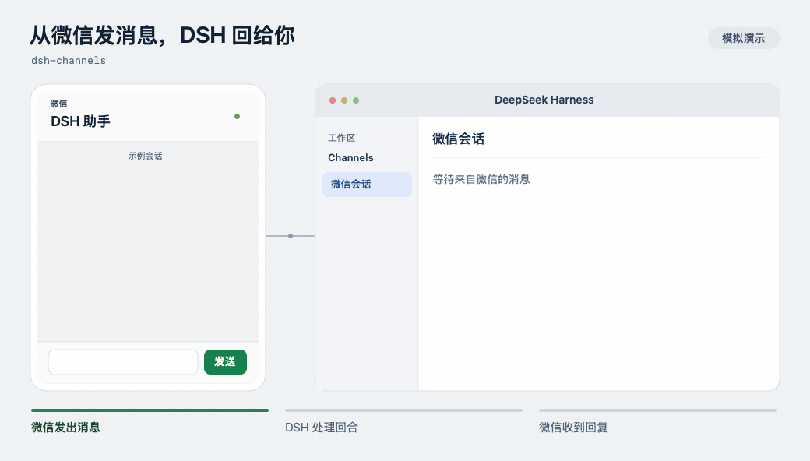

# dsh-channels · 通道

在个人微信或 Telegram 里使用 DeepSeek Harness（DSH）agent。这是一个装进 DSH profile 的插件包（bundle）：发来的消息会进入 DSH 会话，回复、提问、审批和附件会回到原聊天。微信可选配语音转写。



**默认拒绝所有发送者。** 只把信任的人加入白名单。获准的发送者可以用聊天驱动 agent，并按宿主规则审批工具调用。

| 包 | 用途 |
|---|---|
| [`@derekluo/dsh-channels`](packages/core) | DSH 插件（bundle）：会话、权限、交互、重试、桌面状态卡片 |
| [`@derekluo/dsh-channels-weixin`](packages/adapter-weixin) | 个人微信，通过 iLink 长轮询 |
| [`@derekluo/dsh-channels-telegram`](packages/adapter-telegram) | Telegram Bot API，通过长轮询，不用配置 webhook |

## 开始使用

1. 准备装有 DSH 的机器（桌面版或 CLI）和 Node.js 22.13 或更高版本。此前的宿主集成验证使用 DSH `0.2.2-rc.3`；其他版本见[验证状态](docs/STATUS.md)。
2. 按[安装指南](docs/OPERATIONS.md#安装)安装核心及所需适配器；`0.1.0` 发布到 npm 前走该节的源码构建路径。只把核心加进 DSH profile 的 bundle 列表。
3. 按[微信](docs/OPERATIONS.md#微信)或 [Telegram](docs/OPERATIONS.md#telegram)一节配置凭证和适配器，再启动宿主。
4. 给机器人发一条测试消息。从状态目录的 `logs/` 找到 `refused … not-allowed`，核对自己的发送者 ID（微信拒绝行会保留 ID，其他日志会脱敏），再把它加入状态卡片白名单或 `config.json`。通过白名单后，用 `/whoami` 核对发送者、账号和会话 ID。

默认状态目录是 `~/.dsh/channels`；`DSH_CHANNELS_STATE_DIR` 可覆盖。手动编辑 `config.json` 后重启宿主。[配置参考](docs/OPERATIONS.md#配置)列出了默认值和可实时修改的设置。

## 手机和桌面

| 手机命令 | 作用 |
|---|---|
| `/help` | 列出命令 |
| `/whoami` | 查看发送者、通道账号、会话和当前 DSH 会话线 |
| `/status` | 查看当前或最近任务、耗时、执行与投递状态，以及排队和待答情况 |
| `/tasks` | 查看最近 5 项已开始的任务及发送状态。群聊中仅列出自己的任务 |
| `/files [任务ID]` | 查看已完成任务的产物；省略 ID 时查看最近完成任务 |
| `/resend <任务ID> [序号]` | 重新发送一个产物，默认第 1 个；无需重跑任务 |
| `/cancel` | 请求停止自己当前的任务，保留排队消息 |
| `/clear` | 清除自己尚未开始的排队消息，当前任务继续 |
| `/new` | 从下一条普通消息开始使用新会话，保留原会话 |

命令均需通过权限检查；`/status`、`/tasks`、`/cancel`、`/clear`、`/files`、`/resend` 不消耗回合配额，额度耗尽后仍可使用。普通消息保存成功后会收到接收确认。遇到提问时按提示回复序号或文字；审批需按提示携带本次验证码，例如 `a1b2c3 1` 允许一次、`a1b2c3 2` 拒绝。群内交互由发起该回合的人答复。

产物取回示例：先发 `/tasks` 获取任务短编号，再发 `/files a1b2c3d4` 查看序号，最后发 `/resend a1b2c3d4 2` 重发第 2 个文件。群内只能取回自己任务的产物。新任务会记录产物索引；旧版本未记录的文件仍需在 DSH 取回。

停止请求仅控制当前聊天中自己的任务；群内其他成员不能代为取消。只有宿主确认中止或移除尚未消费的输入后，才提示已取消；未确认时提示到桌面核对。取消不会撤销已经完成的操作。`/new` 只切换后续消息使用的会话，不停止当前任务。

桌面聊天中的通道消息带有微信或 Telegram 徽标。宿主支持工作区登记时，会话归入 **Channels**；通道状态和设置在 **Plugins → @derekluo/dsh-channels**。

## 开发与参考

```bash
npm ci
npm test
```

- [运维指南](docs/OPERATIONS.md)：安装、升级与卸载、配置、账号迁移、语音转写和排障。
- [设计](docs/DESIGN.md)与[决策记录](docs/DECISIONS.md)：消息如何进入回合，以及主要设计取舍。
- [适配器指南](docs/ADAPTERS.md)：平台能力、接口和接入步骤。
- [验证状态](docs/STATUS.md)与[变更记录](CHANGELOG.md)：测试范围、已知限制和升级注意事项。

包清单声明 MIT 许可。微信内置传输层的来源与许可见[第三方声明](packages/adapter-weixin/THIRD-PARTY-NOTICES.md)。
