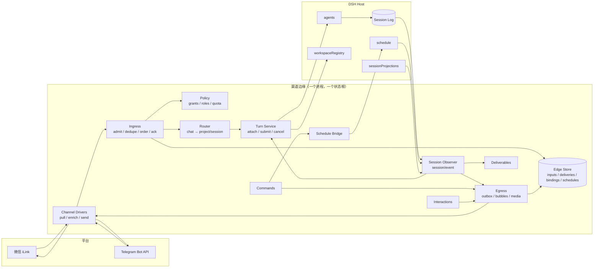
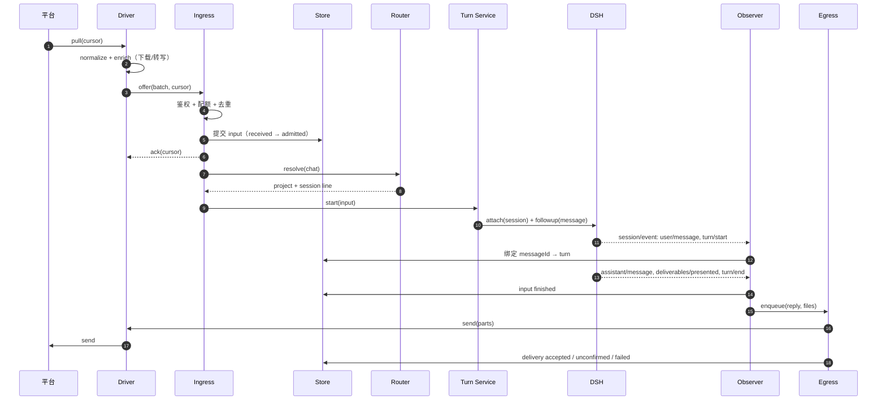
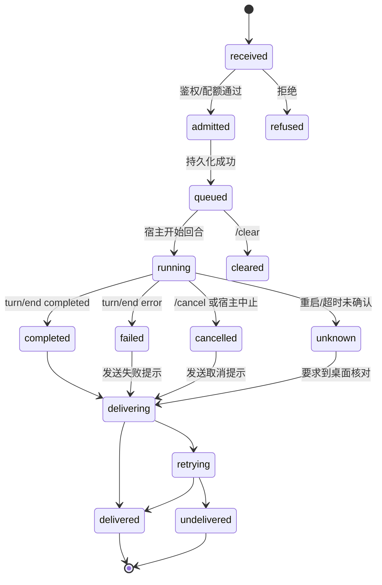
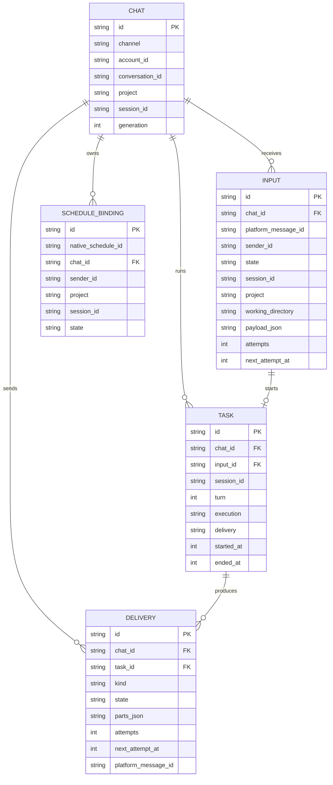

# 重新设计：把 dsh-channels 收回为 DSH 的持久聊天边缘

> 立场：**不重写**。这个项目最难的部分不是代码量，而是它已经在真机上踩过的边界条件。重设计的任务，是保留这些语义，把承载它们的结构换掉。
>
> 基线：DSH `0.2.2-rc.3`，本仓库 `0.1.0`（未发布），392 项测试通过。本文是目标架构提案。
>
> 实施进度（2026-11-18）：事件驱动回合观察、`present` 交付、超时后继续运行并回传晚到结果、`HostPort`、统一的 `state.json`、`IngressSink` driver 入口、待批准配对、可选 `owners` 角色、群聊前缀触发、Telegram 原生交互按钮和可编辑任务卡已落地；剩余为重启已开始回合的结果恢复、旧状态文件一次性迁移和真机验证。

> 实施进度（2026-11-19）：补齐普通文字回复先落盘后发送、同聊天即时发送与重试串行、跨段未确认状态、恢复绑定到 outbox 的原子交接，以及按原宿主输入 ID 只读恢复已开始回合结果。恢复保留完整长回复，待恢复与待投递记录免于历史淘汰。该阶段保留了旧镜像；后续已完成一次性迁移和附件自动重试，见下一条进度。

> 实施进度（2026-11-19 后续）：已实现生成图片的 `present` 指令与安全图片嵌入声明、文字/附件统一持久重试及指纹校验、旧状态一次性迁移到 v2 并归档原始字节；不再双写旧镜像。真实故障已定位为绘图回合未声明附件；修复已部署到 mini 并通过安装后隔离投递检查，原图已补取回索引。详见最新验证记录。

> 后续精简（2026-11-19）：已移除旧 `start`/`onInbound` 接入与 `legacyOutputScan`，`startWithSink` 是唯一入口；本文下方阶段表及早期现状描述保留为历史设计记录，当前接口见 ADAPTERS.md，交付行为见 DESIGN.md。

## 0. 一句话结论

现在的 `dsh-channels` 像一个在 DSH 旁边自己搭的小 DSH：它有自己的收件箱、任务历史、发件箱、会话线、计划表、限流表、持久化和轮询。DSH 已经拥有会话日志、回合、工具、审批、提问、计划和投影；插件却又把这些在 7 个 JSON 文件和一套 JSONL 流水里实现了一遍。于是每个边界条件都要在两处维护，每个“消息现在到哪了”的问题都有两个答案。

顶尖专家会做的是把它收回成 **DSH 的一个持久聊天边缘**：

1. **真相只留一份**：会话和执行归 DSH 的 session log；插件只拥有“准入”和“投递”两本账。
2. **观察改成事件**：用 `session/event` 和 `deliverables/presented` 代替 120ms 轮询和输出目录扫描。
3. **持久化收成一个 store**：一个 schema、一个单写者、显式状态机；不再有 8 个各自为政的状态文件。
4. **适配器只做翻译**：拉取、确认、去重、排序、重试上移到通用 ingress；新增一个通道不再复制一套队列。
5. **宿主边界做成端口**：所有 `ctx.get(...)` 收进一个 `HostPort`，DSH 升级只改一处。

一句话：**把“执行”还给宿主，把“投递”做扎实。**

---

## 1. 这个项目已经是什么

> 下面的“现状”是 2026-11-18 实施前的基线。事件驱动回合观察、`present` 交付和超时后继续运行已落地，见顶部进度。

代码量约 7.5k 行 TypeScript、6.5k 行测试；三个包：核心、微信适配器、Telegram 适配器。`npm test` 当前 369 项全过。它已经不是一个 demo：

- 默认拒绝所有发送者，白名单按账号覆盖；
- 每聊天一条串行队列，不同聊天并行；
- 提问/审批绕过普通队列，审批带一次性验证码；
- 出站两阶段流水，区分“平台已接受”和“未确认”；
- 产物取回做路径包含、符号链接拒绝和私有快照；
- 原生计划只做归属和回传，不自己实现定时器；
- 用模拟宿主覆盖了重启、撤权、损坏状态、慢附件、限流等大量边界。

这些都必须保留。真正的问题不是“做得不对”，而是**做得太多、且分散在错误的层**。

### 1.1 复杂度热点

| 热点 | 证据 | 代价 |
|---|---|---|
| `ChannelsRuntime` 是事实上的 god object | [`runtime.ts`](../packages/core/src/runtime.ts) 828 行、100+ 个条件分支、24 个 catch；同时管适配器、队列、收件箱、任务、发件箱、流水、路由、计划、命令、投递、文件扫描 | 改一个命令要理解整条流水；单测只能从 `dispatch()` 外部打 |
| 回合靠轮询 | [`turns.ts:518`](../packages/core/src/turns.ts#L518) 每 120ms 调 `snapshotEvents()`，注释里也写着“M1 才做事件驱动” | 每个活动回合都有定时唤醒；延迟、CPU、以及重复解析事件 |
| 两套真相 | 宿主 session log + `inbox.json`/`tasks.json`/`outbox.json`/`lines.json`/`schedules.json`/`counters.json`/`journal/` | 崩溃后要回答“谁先写、谁后写、谁赢”，每个文件都有自己的损坏策略 |
| 手写持久化 | 7 个 JSON 文件 + 1 个 JSONL 目录，整文件重写，手写 `validEntry`；[`outbox.ts`](../packages/core/src/store/outbox.ts)、[`inbox.ts`](../packages/core/src/store/inbox.ts)、[`tasks.ts`](../packages/core/src/store/tasks.ts) 各有一套校验 | O(n) 写、同步 FS、格式演进困难；一个坏文件会阻塞整类操作 |
| 适配器承担网关职责 | 微信 405 行 transport 自带批次、游标、确认；Telegram 255 行 transport + 100 行 polling 自带 pending map、前缀确认、重试 | 第三个通道要把这些语义再实现一遍；两套实现的差异就是 bug 的来源 |
| 宿主 API 散落 | `ctx.get('agents'/'agentPresets'/'agentDefaultModel'/'sessionTitle'/'schedule'/'sessionPersistence'/'webServer'/'connection')` 分散在 3 个文件 | DSH 升级时没有单一适配点；测试只能逐个伪造 |
| 文件交付靠提示词 + 目录扫描 | [`turns.ts:408`](../packages/core/src/turns.ts#L408) 往用户消息里塞隐藏指令；[`produced.ts`](../packages/core/src/produced.ts) 扫描 `.channel-output-*`；[`client.js:64`](../packages/core/client.js#L64) 再把它隐藏 | 模型不照做就丢文件；渲染器要知道这个约定；每回合最多扫 10000 项 |
| 首次授权靠翻日志 | README 让用户从 `refused … not-allowed` 日志里找自己的 ID | 安全但敌意；第一次成功使用的路径太长 |
| 测试按 review 轮次组织 | `review-regressions`、`review-round-two`、`whole-review-fixes`、`reliability-fixes`、`design-fixes`、`delivery-review` 六个文件约 1.2k 行 | 测试在记录“哪一轮修了什么”，而不是“系统必须永远满足什么” |
| 没有 CI / lint / metrics | 仓库无 `.github`，无格式化/静态检查脚本 | 回归靠人肉 review 发现；发布质量靠运气 |

这些不是十个独立问题，而是同一个问题的十个症状：**插件在宿主之外又建了一个运行时。**

---

## 2. 设计原则

1. **宿主拥有执行，插件拥有投递。** 会话、回合、工具、审批、提问、计划执行都属于 DSH。插件只决定“谁能进来”和“结果怎么出去”。
2. **一条输入，一条生命周期记录。** 每个平台消息只有一个 durable 记录，状态迁移显式、幂等、可恢复。
3. **事件优先，轮询只做兜底。** 回合结束、文件交付、计划结果都从 `session/event` 派生；定时器只用于超时和重试。
4. **单一真相，缓存可重建。** 插件自己的表是投递账本；任务状态能从 session log 重建，就不另存一份“执行状态”。
5. **适配器只翻译。** 平台差异留在 driver；去重、排序、确认、重试、配额属于 gateway。
6. **一个宿主端口。** 所有 DSH 服务访问收进 `HostPort`；能力检测在启动时完成，运行时不猜。
7. **授权一次，携带凭证。** 准入时发一个带 epoch 的 grant；异步副作用前校验 grant，而不是在每个 await 后重新查白名单。
8. **先提交，后确认。** 平台游标只在 durable handoff 之后推进；副作用之前先写 intent。
9. **至少一次，不承诺恰好一次。** 平台没有幂等键；诚实地说“未确认”，比假装“已送达”好。
10. **可观测性是功能。** 每个输入有 trace id；每个拒绝有 reason code；每个失败有用户可读的下一步。

---

## 3. 目标架构

### 3.1 容器视图



关键点：**只有 Ingress 和 Egress 碰 Store；只有 HostPort 碰 DSH 服务；适配器不碰 Store。**

### 3.2 一条消息的目标路径



### 3.3 输入生命周期



注意 `running → unknown` 而不是 `running → failed`：重启后能读到 `turn/end` 就算完成，读不到就诚实显示未知，**不重跑**。

### 3.4 数据模型



`CHAT` 取代 `lines.json` 里的嵌套 map；`TASK` 只保留索引，`execution` 能从 session log 重新推导；`DELIVERY` 是插件真正拥有的账本。

---

## 4. 关键设计决策

### D1. 用一个 `HostPort` 隔离 DSH

**现状**：`ctx.get` 直接出现在 `index.ts`、`turns.ts`、`schedules.ts`；每个调用都自己 `as` 成结构类型，自己处理“服务不在”。

**目标**：

```ts
interface HostPort {
  readonly capabilities: HostCapabilities
  agents: {
    get(id: string): Agent | undefined
    create(options: CreateAgentOptions): Promise<AgentHandle>
    resume(options: ResumeAgentOptions): Promise<AgentHandle>
  }
  events: {
    onSession(listener: (session: Session, event: SessionEvent) => void): () => void
  }
  projections: {
    register<S>(unit: ProjectionDefinition<string, S>): Promise<ProjectionHandle<S>>
  }
  schedules: {
    create(request: NativeScheduleRequest, actor?: string, signal?: AbortSignal): Promise<NativeTask>
    catalog(): Promise<NativeTask[]>
    edit(request: NativeScheduleEdit): Promise<NativeScheduleResult>
  }
  workspace: {
    ensure(directory: string, title: string): Promise<WorkspaceHandle | undefined>
    attach(workspace: WorkspaceHandle, sessionId: string): Promise<void>
  }
  interactions: {
    onQuestion(listener: QuestionListener): () => void
    onApproval(listener: ApprovalListener): () => void
  }
  title: { rename(session: Session, title: string): Promise<void> }
  web: { registerStatus(handler: StatusHandler): () => void }
}
```

**规则**：`packages/core/src/host/` 之外不允许出现 `ctx.get`。用一条测试强制执行：

```ts
test('only the host port reaches into ctx', () => {
  const offenders = sourceFiles()
    .filter((file) => !file.endsWith('host/dsh.ts'))
    .filter((file) => /\.get\?\.\(/.test(read(file)))
  assert.deepEqual(offenders, [])
})
```

这是“架构适应度函数”，比文档可靠。收益：DSH 升级只改 `host/dsh.ts`；测试用一个 `FakeHostPort`，不再伪造半个 Cordis。

### D2. 回合观察改成 `session/event`，并把“等待超时”与“取消执行”分开

**现状**：`TurnProgress` 已经是一个很好的纯 reducer，但它的输入来自 `snapshotEvents()` 轮询。`maxTurnWaitMs` 超时会 abort 信号，信号触发 `agent.cancel()`，于是**手机端等不及会把一个可能快完成的长任务杀掉**。

**目标**：

```ts
host.events.onSession((session, event) => {
  const binding = observers.get(session.id)
  if (binding === undefined) return
  binding.progress.update([event])          // 纯 fold
  if (event.type === 'deliverables/presented') binding.files.push(...event.data.files)
  if (event.type === 'turn/end') binding.finish(event.data.reason)
})
```

- `TurnProgress` 保留，改成“推事件”而不是“拉事件”；删除 `pollMs`、`turnPollMs`。
- 提交前先注册 session 观察；事件是同步 feed，不会错过快速回合。
- **等待超时只停止等待并通知**，不取消回合；`/cancel` 是唯一的用户取消入口。长任务在 20 分钟后仍可完成，结果通过同一个 observer 回来。需要硬上限时用独立的 `cancelAfterMs`，默认关闭。
- 重启恢复：对每个 `running` input，读该 session 的日志，找到同一 `messageId` 的 `user/message` 和其后的 `turn/end`。有终态就投递；没有就标 `unknown`。**不重跑已开始的回合**，但也不丢已经完成的答案。当前实现会丢：它只恢复收件箱，不恢复已开始回合的结果。

这条决策单独就能删掉轮询、超时误杀和“结果未知”的一大半来源。

### D3. 一个 store、一个 schema、一个单写者

**现状**：8 个状态文件、每个文件一套校验、一套损坏策略。`Inbox.add` 整文件重写；`Tasks.save` 重写最多 500 条；`Outbox.add` 重写整个队列；`journal.received` 首次读当天整份 JSONL。同步 FS 在消息路径上。

**目标**：

- 优先用宿主 `storageDomain` 的 `channels` 域；没有域时用一个 JSON 文件（不是八个）或 SQLite 回落。统一接口：
  ```ts
  interface Store {
    chats: Repo<Chat>
    inputs: Repo<InputRecord>
    tasks: Repo<TaskRecord>
    deliveries: Repo<DeliveryRecord>
    schedules: Repo<ScheduleBinding>
    counters: Repo<CounterRecord>
    commit(batch: Mutation[]): Promise<void>
    迁移(): Promise<MigrationReport>
  }
  ```
- 所有记录用 Zod schema 定义；类型从 schema 推导，不再手写 `validEntry`。
- 记录 key 用 UUID/ULID（宿主 `per-record` 布局只接受 `[a-zA-Z0-9_-]+` 路径段；不要用 `channel|account|conv` 直接做 key）。
- 需要跨表原子性的迁移，写成一条 `intent` 记录 + 幂等投影；或者直接把宿主域路由到 SQLite 后端。不要假装 JSON 文件有事务。
- 启动时对状态根加独占锁；第二个实例拒绝启动。当前文档明确“不协调多实例”，但只是口头约定。
- 旧状态一次性迁移：读 8 个状态文件 → 写新 store → 旧文件改名 `.bak`；迁移失败则拒绝启动，并给出 `doctor --migrate`。不要长期双写。
- 保留 `doctor`，但让它读新 schema；`layout.ts` 从“文件清单”变成“表清单”。

### D4. 适配器变成 pull/ack driver

**现状**：微信和 Telegram 各自实现了批次、游标、去重、排序、重试、附件队列。核心又实现了一遍收件箱、配额预留、去重。三层队列叠加。

**目标**：

```ts
interface ChannelDriver {
  readonly id: string
  readonly label: { zh: string; en: string }
  readonly capabilities: {
    maxTextChars: number
    media: { image: boolean; file: boolean; voice: boolean; video: boolean }
    actions: 'none' | 'inline' | 'buttons'
    edit: boolean
    typing: boolean
    maxInboundBytes: number
  }
  start(sink: IngressSink): Promise<void>
  stop(): Promise<void>
  send(target: Target, message: Outgoing): Promise<SendResult>
  enrich?(raw: RawInbound, signal: AbortSignal): Promise<Inbound>
}

interface IngressSink {
  /** 返回时表示已 durable 提交；失败则平台游标不前进。 */
  offer(batch: RawBatch, cursor: Cursor): Promise<void>
}
```

- Driver 只负责：拉取、解析平台格式、下载/转写附件、发送。
- Gateway 负责：鉴权、配额、去重（platform id 唯一索引）、每聊天排序、ack 游标、重试退避、失败分类。
- 微信的 `contextToken`、Telegram 的 `update_id`/`message_id` 留在 driver；核心只看到统一的 `Inbound`。
- 适配器契约加 `contractVersion` 和一个共享 conformance suite；第三个通道先用 fake transport 跑同一套。
- 微信的 `process.env['OPENCLAW_STATE_DIR']` 是进程级全局；改成显式传参，做不到就把微信 driver 放进独立进程/worker，用 JSON-line IPC 通信。非官方 API 的不稳定不应该拖垮 gateway。

### D5. 文件交付改用 `deliverables/presented`，删掉输出目录魔法

**现状**：每回合在 workspace 建 `.channel-output-*`，在用户消息里插入一段隐藏指令，让模型把文件复制进去；回合后扫描目录；`client.js` 再根据 `hasOutputInstruction` 隐藏第一段。模型不照做就没有文件；扫描还可能漏、慢、误发。

**目标**：

- 直接观察宿主的 `deliverables/presented` 事件（`present` 工具成功后写入，带 `turn`、`callId`、`files`）。这是模型和桌面共用的“交付”语义。
- 回合结束时，按 `turn` 把文件挂到对应 input 的 delivery；路径仍做包含校验和安全快照（保留现有 [`artifacts.ts`](../packages/core/src/artifacts.ts) 的复制逻辑）。
- 删除隐藏文本块、`hasOutputInstruction`、`client.js` 的对应分支、`.channel-output-*` 的创建/清理，以及默认的 10k 目录扫描。
- 保留一个显式配置的 legacy scan 作为兜底（默认关闭），只对没有 `present` 的旧 preset 生效；不要把它当主路径。
- 如果某个 skill 生成文件却不 `present`，修 skill 的提示词，不要在 gateway 里加目录约定。

收益：文件交付从“提示词约定”变成“宿主事件”；少一次目录扫描；桌面和手机看到同一份交付；不再依赖渲染器隐藏文本。

### D6. 交互用能力驱动的 surface，而不是人人编号文本

**现状**：所有通道都是“编号 + 文字回复”；审批用六位验证码 + 序号。Telegram 明明有 inline keyboard，微信没有，但核心只提供文本。`Outgoing.kind` 只有 `reply|notice|question`；`Capabilities.buttons/edit` 还被标记为 deprecated。

**目标**：

```ts
interface InteractionPrompt {
  id: string
  kind: 'question' | 'approval'
  title: string
  body?: string
  actions: Array<{ id: string; label: string; style?: 'primary' | 'danger' }>
  freeText?: boolean
  expiresAt: number
}
```

- 核心生成抽象 prompt；driver 按 `capabilities.actions` 渲染：
  - Telegram：inline keyboard + `callback_query`，`answerCallbackQuery` 确认；`editMessageText` 把“等待中”改成“已处理”。
  - 微信：编号文本 + 验证码兜底。
- 审批的 `callback_data` 绑定 `interactionId + nonce`，不需要用户抄验证码；文本通道仍保留验证码。
- 审批增加尝试次数上限（例如 3 次），并绑定发起者/聊天；六位 hex 只有 24 bit，群聊里验证码是公开的。
- 用 `agent/created` 在 `agent.ctx` 上注册该 agent 的 interaction listener，替代“全局 listener + `interactionForAgent` 反查”。agent 销毁时自动清理。
- 区分 blocking `ask` 与 `askTimed` 的 continued question：后者要调 `ctx.userQuestions.answer(agent, callId, answer)`，不能只抢 waterfall；否则超时后用户再回复会被当成新回合。这是当前实现的一个真实缺口。

### D7. 准入发 grant，而不是在每个 await 后重查

**现状**：`authorizeMessage` 在预检、dispatch、队列开始、计划创建、计划激活、计划投递、outbox 重试等处反复调用。原因是异步等待期间权限可能变化；代码用“每处再查一次”解决，导致 10 个检查点和大量重复。

**目标**：

```ts
interface Grant {
  inputId: string
  chatId: string
  senderId: string
  role: 'owner' | 'member'
  project: string
  sessionId: string
  epoch: number
  expiresAt: number
}
```

- `Policy.admit(message)` 返回 grant；异步任务捕获 grant。
- 配置/白名单/账号状态变化时 `epoch++`；副作用前只做 `policy.validate(grant)`（比较 epoch、账号过期、项目仍允许）。
- 角色从“字符串白名单”升级为 `{ senderId, role, projects?, quota? }`；旧配置解析成 `member`，保持兼容。
- 群聊增加触发策略：`mention | prefix | all`。当前群聊里任何获准成员的每条消息都会启动回合，这既吵又烧钱；默认要求 `@bot` 或 `/ask` 前缀。
- 首次配对改成“请求 → 桌面批准”：未知发送者只产生一条 pending 记录（限流、TTL、上限 20），状态卡片列出 sender/chat/first message，管理员点“允许”；不再要求用户去日志里找 ID。默认拒绝不变，但第一次成功使用的路径从“读日志”变成“点一下”。

### D8. 命令变成声明式注册表

**现状**：`#runCommand` 是一个 120 行的 if-chain；命令的帮助文本、配额豁免、权限、参数解析分散在 `commands.ts` 和 runtime。

**目标**：

```ts
interface Command {
  name: string
  aliases?: string[]
  summary: { zh: string; en: string }
  usage: string
  auth: 'member' | 'owner'
  quota: boolean
  parse(args: string): Result<Args, string>
  run(ctx: CommandContext, args: Args): Promise<CommandResult>
}
```

- `/help` 从注册表生成；Telegram `setMyCommands` 也从注册表生成。
- 每个命令一个模块，独立测试；runtime 只做 `find → auth → parse → run → send`。
- 命令不再散落在 `runtime.ts`；`/status` / `/tasks` / `/files` 可以共享一个 `taskView` 查询层。

### D9. 计划桥只做归属和回传

**现状**：`ChannelSchedules` 做原生创建/编辑/目录查询/history 读取/进度恢复/结果投递，250 行；`sync()` 每 30 秒由 outbox retry 触发；`canDeliver()` 每次发送气泡都重新 `catalog()` + 授权两次。

**目标**：

- 原生 `schedule` 是唯一执行真相；插件只存 `scheduleId → chat/sender/project/session` 的绑定和回传游标。
- 结果回传用 `session/event` observer，不读 `sessionPersistence` 热路径；重启时对每个绑定做一次日志恢复，不每 30 秒扫。
- `canDeliver` 每个投递批次检查一次，缓存 schedule 状态，收到 `schedule/*` 事件或 TTL 过期再失效；不要每个气泡查两次 catalog。
- 绑定删除用“先标记 deleting，再删原生，再删行”的幂等顺序；保留当前的 `schedule/resolve-agent` 守卫和“项目失效仍允许创建者删除”的语义。

### D10. 错误、日志、指标

**现状**：大量 `catch` 只写 `String(error)`；有些路径把 `String(error)` 直接当回复发给用户（[`runtime.ts:623`](../packages/core/src/runtime.ts#L623)）。日志是自由文本；没有指标；`/status` 只给最近流水。

**目标**：

```ts
class ChannelError extends Error {
  constructor(
    readonly code: string,
    readonly userMessage: string,
    readonly retryable: boolean,
    readonly detail?: unknown,
  ) { super(code) }
}
```

- 统一错误目录，例如：`model-unavailable`、`session-cwd-mismatch`、`approval-unavailable`、`turn-timeout`、`platform-rate-limited`、`outbox-persist`、`artifact-unavailable`。每个都有用户可读的下一步。
- 日志改成结构化字段：`{ traceId, channel, accountId, chatId, inputId, sessionId, turn, event, code }`；默认不记录完整消息正文。
- 指标：ingress 结果、回合时延、投递状态、outbox 深度、交互结果、store 错误、适配器最后成功拉取/发送时间。
- `/status` 变成健康矩阵：适配器状态、最后轮询、最后发送、账号过期、store 状态、outbox、pending pairing、最近错误；桌面卡片直接操作。

### D11. 安全、隐私、保留

- **工具权限按角色收窄**：当前白名单是二元的，群成员一旦获准就能用全部工具。用宿主 `ctx.tools.restrict()` / permission preset 给不同角色不同工具集：`owner` 全量；`member` 只读 + 需要审批的写；`guest` 只能问答。
- **群成员校验**：如果平台能列出群成员，允许“发送者在白名单”之外再校验群成员；至少不要让已退群的人继续用。
- **审批尝试上限**、验证码长度、绑定发送者；文本通道和按钮通道都要。
- **保留策略**：入站媒体、journal、tasks、outbox 各有 TTL；增加 janitor 和 `/delete-my-data`（或桌面按钮）。当前媒体只增不减。
- **目录权限**：状态根 0700、文件 0600（当前文件 0600，目录默认可能更宽）。
- **日志脱敏**：保持现有 `redact`，但默认不写消息正文；调试模式显式开启。
- **单写者锁**：见 D3。

### D12. UX：少发消息，发对消息

- **一条任务卡**：Telegram 支持编辑，把 `已接收 → 执行中 → 完成` 放在同一条消息里；微信不支持编辑，只在排队时发一次确认、完成时发结果，长任务超过 2 分钟再发一次进度，不要 60 秒固定提醒。
- **配对**：见 D7；首次使用从“读日志”变成“桌面点允许”。
- **群聊**：默认只在 `@bot` / `/ask` 时响应；`/status` 仍可用。
- **错误**：不要“任务执行失败，请在 DSH 核对”这种万能句；按错误码给下一步（“模型未选择 → 在 DSH 选择模型”；“目录已变 → /project 或 /new”）。
- **命令发现**：Telegram 命令菜单；微信 `/help` 按“任务控制 / 项目 / 计划 / 诊断”分组，而不是 15 行平铺。

### D13. 测试按不变量组织，CI 强制

**现状**：六个 review 命名文件记录修复历史；测试通过 `pollMs` 等待轮询；没有 CI。

**目标**：

- 领域套件：`admission`、`ingress`、`turn-observer`、`delivery`、`interactions`、`schedules`、`artifacts`、`store`、`drivers`。
- 每个套件写**不变量**，不是场景清单：
  1. 同一条平台消息不会执行两次（崩溃/重投/重启）。
  2. 每条 admitted input 最终处于 completed / failed / cleared / visible-pending 之一。
  3. 每个 completed turn 的回复至少投递一次，或明确显示 undelivered。
  4. 撤权/epoch 变化后，旧的异步任务不能创建、执行或投递。
  5. 同聊天投递顺序保持；不同聊天互不阻塞。
  6. 路径穿越、符号链接、超限文件永远不会被发送。
  7. 重启不重跑已开始的回合；已完成的回合结果不丢。
- 属性测试：`splitIntoBubbles`（不丢字、不超限、幂等）、store codec（round-trip、损坏拒绝）、状态机（无非法迁移）。
- 模型测试：随机生成 `inbound / send-fail / restart / revoke / clear / schedule-fire` 序列，断言上述不变量。
- 适配器 conformance：同一套契约测试跑微信/Telegram fake transport；再加一个 DSH 事件 fixture 回放。
- 旧的 review 用例不要删，迁到 `test/regressions/` 并在文件头写 issue/commit；顶层只留领域套件。
- CI：`npm ci` → lint/format → `tsc --noEmit` → test → `npm pack` 检查；Node 22/24 矩阵；加架构适应度测试（`ctx.get` 只允许在 host port；store 只允许在 ingress/egress）。

### D14. 发布与文档

- 加 `Biome` 或 `ESLint + Prettier`；当前代码风格在 `schedules.ts` 里已经压成一行，review 成本高。
- 用 changesets 管理 0.x 版本；`npm publish --provenance`；CI 验证三个包的 `npm pack` 内容。
- README 第一屏改成“3 步配对”，不是“去日志找 refused”。
- 配置参考、命令表、状态表从 schema/注册表生成，避免文档和代码漂移。
- `DESIGN.md` 拆成：架构图、生命周期状态机、失败矩阵、不变量；把“为什么”留在 ADR，把“是什么”留给代码和测试。

---

## 5. 迁移路线

不要大爆炸。每个阶段独立可发布、可回滚。

| 阶段 | 动作 | 删除 | 验证 | 风险 |
|---|---|---|---|---|
| **0. 地基**（1–2 天） | CI、lint/format、架构适应度测试、`.DS_Store` 清理、依赖整理 | 无 | `npm test` + `npm pack` 在 CI 通过 | 低 |
| **1. HostPort + 事件观察**（3–5 天） | 已完成事件观察、超时后继续运行、晚到结果回传和 `HostPort`；重启日志恢复待做 | 生产路径的 `snapshotEvents` 轮询、散落的 `ctx.get` | 事件 fixture、长任务不误杀、晚到结果、架构测试 | 中：需要真实 DSH 事件形状 |
| **2. Deliverables**（3–5 天） | 已接 `deliverables/presented`；默认不再注入隐藏文本块/扫描，`legacyOutputScan` 保留旧 preset 兜底 | `produced.ts` 主路径、默认输出目录扫描 | 真机发图/文件、present 失败回退 | 中：preset 必须挂 `present` |
| **3. 一个 store**（1–2 周） | 已完成 `state.json` 权威副本与旧文件镜像迁移；显式 inputs/deliveries 状态机与单写者锁仍待做 | 6 个独立写路径、手写逐文件持久化 | 迁移、镜像导入、损坏拒绝 | 中：数据迁移（已用镜像降低风险） |
| **4. Driver 契约**（1–2 周） | 已新增 `IngressSink` / `startWithSink`，核心按聊天串行 durable handoff、去重和重试；平台批次/游标确认与媒体顺序仍在 driver | 适配器内的 durable 重试循环 | ingress 合约、双通道回归 | 中：平台差异 |
| **5. 产品与运维**（持续） | 配对、角色/工具收窄、原生按钮、任务卡、指标、保留策略 | 日志找 ID、固定 60s 提醒、纯文本审批 | 真机、群聊、首次使用计时 | 中 |

**顺序理由**：先做 1 和 2，因为它们直接删掉轮询和目录魔法，风险低、收益大；再做 3，因为它是所有崩溃语义的地基；最后做 4，因为驱动契约需要前三个稳定后才能定形。配对/角色可以并行，但不要早于 3，否则又要写一套临时状态。

---

## 6. 怎么判断重设计成功

| 指标 | 现在 | 目标 |
|---|---|---|
| 回合回复延迟 | 轮询 120ms，平均多 60ms | 事件驱动，p95 增加 < 10ms |
| 崩溃后已开始回合的结果 | 只恢复收件箱，结果可能丢 | 从日志恢复完成结果；读不到才 unknown |
| 同一条消息重复执行 | 靠 inbox + journal 去重 | 平台 ID 唯一索引 + 幂等状态机，0 重复 |
| 状态文件 | 7 个 JSON + 1 个 JSONL 目录 | 1 个 store（+ 备份） |
| `ctx.get` 出现位置 | 3 个文件、8 处 | 仅 `host/dsh.ts` |
| 适配器新增成本 | 复制 300–400 行 | driver ~200 行 + 契约测试 |
| 首次成功使用 | 读日志、手改配置 | 桌面点“允许”，< 3 分钟 |
| 文件交付 | 提示词约定 + 目录扫描 | `present` 事件，确定性 |
| 测试组织 | 6 个 review 文件 | 领域套件 + regressions |
| 发布 | 手工 | CI + provenance |

---

## 7. 不建议做的事

- **不要重写成 Go/Rust 或换框架。** 问题在职责边界，不在语言。
- **不要做 Web 聊天 UI。** 聊天软件就是 UI；桌面已经有 DSH。
- **不要自己实现定时器。** 原生 `schedule` 已经处理了恢复、时区、RRULE。
- **不要在 driver 契约之前加第三个通道。** 否则会把两套队列复制成三套。
- **不要继续加命令。** 先把配对、群聊触发、错误文案做好；命令越多，文本 UI 越难用。
- **不要承诺 exactly-once。** 平台没有幂等键；诚实的 `unconfirmed` 比假的 `delivered` 有价值。
- **不要长期保存消息正文。** 默认脱敏 + TTL；调试模式显式开启。
- **不要在多账号之前做多账号。** 单账号的崩溃恢复、配对、群聊还没做到“无聊地可靠”。

---

## 8. 如果只做三件事

1. **事件驱动 + deliverables**：删掉 `snapshotEvents` 轮询、隐藏输出指令、目录扫描。这是投入产出比最高的一步。
2. **一个 store + 显式状态机**：把 8 个状态文件和散落的回滚逻辑收成一本账；崩溃语义从此可测试。
3. **HostPort + driver 契约**：让 DSH 升级和第三个通道都不再修改核心。

做完这三件，再谈配对、角色、原生按钮和任务卡。顺序反过来会做出一个更漂亮的 demo，但不会做出一个更可靠的产品。

---

## 附录 A：依赖的宿主能力（已核对）

这些不是设想中的 API，而是当前安装的 DSH `0.2.2-rc.3` 已提供的能力。重设计成立的前提，是继续使用它们，而不是在插件里重造。

| 能力 | 宿主接口 | 在目标架构中的用途 |
|---|---|---|
| 会话事件 | `session/event (session, event)`，提交后同步广播 | 回合开始/结束、assistant 文本、交付事件的唯一输入 |
| 会话日志 | `session.snapshotEvents` / `sessionPersistence.open(id, 'read')` | 启动恢复；只读一次，不轮询 |
| 投影 | `ctx.sessionProjections.register(definition)` | 可选的派生状态；纯 fold、可检查点 |
| 文件交付 | `present` 工具写入 `deliverables/presented` | 替代输出目录约定 |
| 持久化 | `ctx.storageDomain.open(spec)`，`single`/`per-record` | 投递账本、绑定、配额；SQLite/JSON 后端由宿主选择 |
| 原生计划 | `ctx.schedule.create/catalog/edit/history` | 执行归宿主；插件只做归属与回传 |
| 提问 | `ctx.userQuestions.ask/askTimed/answer` + `user-questions/request` | blocking 与 continued 提问 |
| 审批 | `approval/request` seam | 一次性审批；与桌面竞速 |
| 工作区 | `ctx.workspaceRegistry.create/attachSession` | 会话分组 |
| 标题 | `ctx.sessionTitle.rename`（通常可省略） | 宿主会从首条 human message 自动生成 |
| 工具限制 | `agent.ctx.tools.restrict()` / permission preset | 按角色收窄手机端工具集 |
| 客户端行 | `conversation.chat.node` + `ctx.uiConversation.events.register` | 桌面通道徽标；应从共享 manifest 生成 |

---

## 附录 B：现有文件到目标模块的映射

| 现在 | 目标 |
|---|---|
| [`runtime.ts`](../packages/core/src/runtime.ts) | `gateway/runtime.ts` + `gateway/ingress.ts` + `gateway/egress.ts` + `commands/` |
| [`turns.ts`](../packages/core/src/turns.ts) | `turns/attach.ts` + `turns/submit.ts` + `turns/observer.ts` |
| [`index.ts`](../packages/core/src/index.ts) | `plugin.ts` + `host/dsh.ts` + `web/status.ts` |
| [`store/*`](../packages/core/src/store) | `store/schema.ts` + `store/domain.ts` + `store/migrate.ts` |
| [`schedules.ts`](../packages/core/src/schedules.ts) | `schedules/bridge.ts` |
| [`artifacts.ts`](../packages/core/src/artifacts.ts) / [`produced.ts`](../packages/core/src/produced.ts) | `files/deliverables.ts` + `files/snapshot.ts` |
| [`adapter-weixin/src/transport.ts`](../packages/adapter-weixin/src/transport.ts) / [`adapter-telegram/src/polling.ts`](../packages/adapter-telegram/src/polling.ts) | `drivers/weixin.ts` / `drivers/telegram.ts` + 通用 `ingress/consumer.ts` |
| [`client.js`](../packages/core/client.js) `CHANNELS` | 构建期生成的 channel manifest，或 `/channels/status` 动态注册 |
| `test/review-*.test.ts` | `test/domains/*` + `test/regressions/*` |

---

## 附：一句话给未来的维护者

> 每当你想在插件里再加一个队列、一个 JSON 文件、一个“先查一下权限”的 await 后检查，先问：**这件事 DSH 是不是已经知道了？** 如果知道，读它；如果不知道，只记投递账本。这样这个项目会越来越小，而不是越来越大。
